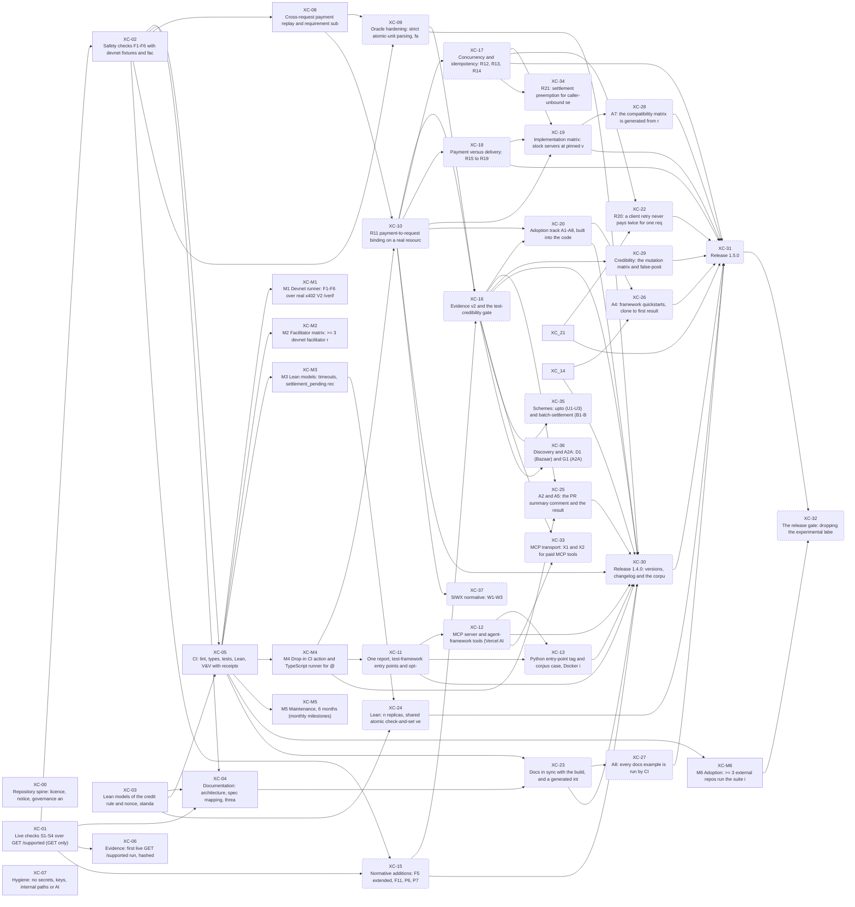

# Interdependency map

Generated by `python3 tools/interdeps.py` from `proofline.json`, the proposed addenda in `docs/proposals/` and the tracked tree. Don't edit by hand: `python3 tools/interdeps.py --check` fails when this file is stale; CI starts running it once contract task XC-23 is signed. Signed means the task is in the owner-signed contract. Proposed means it sits in an unsigned addendum and binds nothing yet. Static criteria are the grep and file checks, counted here; `tools/vv.py` runs the rest.

## Task graph

Square boxes are signed, round boxes proposed.

Dependencies on tasks not in this tree yet (their addendum is on another branch): XC-14, XC-21.

## Tasks

| task | phase | status | depends on | needed by | requirements | static criteria | scope (tracked files) |
|---|---|---|---|---|---|---|---|
| XC-00 Repository spine: licence, notice, governance and contract | design | signed | - | - | R-OPEN, R-GOV | 7/7 | `LICENSE` (1); `NOTICE` (1); `README.md` (1); `CONTRIBUTING.md` (1); `CODE_OF_CONDUCT.md` (1); `SECURITY.md` (1); `CHANGELOG.md` (1); `.gitignore` (1); `.github/CODEOWNERS` (1); `.github/ISSUE_TEMPLATE/**` (6); `.github/pull_request_template.md` (1); `guard/**` (1); `proofline.json` (1); `proofline.json.sig` (1); `pyproject.toml` (1) |
| XC-01 Live checks S1-S4 over GET /supported (GET only) | implement | signed | - | XC-02, XC-04, XC-06, XC-15 | R-S1, R-S2, R-S3, R-S4, R-SAFE-GET | 0/0 | `src/x402conf/__init__.py` (1); `src/x402conf/__main__.py` (1); `src/x402conf/py.typed` (1); `src/x402conf/spec.py` (1); `src/x402conf/types.py` (1); `src/x402conf/harness.py` (1); `src/x402conf/cli.py` (1); `tests/test_live.py` (1) |
| XC-M1 M1 Devnet runner: F1-F6 over real x402 V2 /verify and /settle on Solana devnet | implement | signed | XC-05 | - | R-GRANT | 2/2 | `src/x402conf/devnet/**` (8); `tests/test_devnet.py` (1); `evidence/devnet/**` (3) |
| XC-02 Safety checks F1-F6 with devnet fixtures and facilitator doubles | implement | signed | XC-01 | XC-04, XC-05, XC-08, XC-09, XC-15 | R-F1, R-F2, R-F3, R-F4, R-F5, R-F6 | 0/0 | `src/x402conf/mock.py` (1); `src/x402conf/fixtures/**` (1); `tests/test_offline.py` (1) |
| XC-M2 M2 Facilitator matrix: >= 3 devnet facilitator reports, with operator permission | verify | signed | XC-05 | - | R-GRANT | 1/1 | `evidence/matrix/**` (0); `docs/MATRIX.md` (1) |
| XC-03 Lean models of the credit rule and nonce, standard axioms only | verify | signed | - | XC-04, XC-05, XC-24 | R-LEAN | 7/7 | `lean/lean-toolchain` (1); `lean/lakefile.toml` (1); `lean/lake-manifest.json` (1); `lean/X402Conformance.lean` (1); `lean/X402Conformance/**` (3); `lean/Axioms.lean` (1); `tools/lean_axioms.py` (1) |
| XC-M3 M3 Lean models: timeouts, settlement_pending reconciliation, concurrent settles | verify | signed | XC-05 | XC-24 | R-GRANT | 2/2 | `lean/X402Conformance/Pending.lean` (1) |
| XC-04 Documentation: architecture, spec mapping, threat model, roadmap, V&V | verify | signed | XC-01, XC-02, XC-03 | XC-23 | R-DOCS | 13/13 | `docs/**` (15) |
| XC-M4 M4 Drop-in CI action and TypeScript runner for @x402/svm resource servers | integrate | signed | XC-05 | XC-10, XC-11, XC-25 | R-GRANT | 2/2 | `action.yml` (1); `ts/**` (42) |
| XC-05 CI: lint, types, tests, Lean, V&V with receipts | integrate | signed | XC-02, XC-03 | XC-M1, XC-M2, XC-M3, XC-M4, XC-M5, XC-M6, XC-23 | R-CI | 2/2 | `.github/workflows/**` (2); `tools/vv.py` (1); `tools/verify-sig.mjs` (1); `vv/claims.json` (1) |
| XC-M5 M5 Maintenance, 6 months (monthly milestones) | monitor | signed | XC-05 | - | R-GRANT | 0/0 | `docs/MAINTENANCE.md` (0) |
| XC-06 Evidence: first live GET /supported run, hashed and reproducible | verify | signed | XC-01 | - | R-EVID | 2/2 | `evidence/**` (28); `tests/test_live.py` (1) |
| XC-M6 M6 Adoption: >= 3 external repos run the suite in CI; >= 5 facilitators with published results | monitor | signed | XC-05 | XC-32 | R-GRANT | 0/0 | `docs/ADOPTION.md` (1) |
| XC-07 Hygiene: no secrets, keys, internal paths or AI attribution; commits by mgillr | release | signed | - | - | R-HYG | 0/0 | - |
| XC-08 Cross-request payment replay and requirement substitution are rejected | implement | signed | XC-02 | XC-09, XC-10 | R-F10 | 0/0 | `src/x402conf/mock.py` (1); `src/x402conf/harness.py` (1); `tests/test_offline.py` (1); `docs/SPEC.md` (1); `docs/FIXES.md` (1) |
| XC-09 Oracle hardening: strict atomic-unit parsing, fail closed | implement | proposed | XC-02, XC-08 | XC-16, XC-30 | R-ORACLE | 0/0 | `src/x402conf/mock.py` (1); `src/x402conf/harness.py` (1); `tests/test_offline.py` (1); `ts/src/**` (11); `ts/test/**` (4) |
| XC-10 R11 payment-to-request binding on a real resource server | implement | proposed | XC-M4, XC-08 | XC-16, XC-17, XC-18, XC-19, XC-20, XC-30, XC-37 | R-R11 | 1/1 | `ts/**` (42); `src/x402conf/harness.py` (1); `docs/SPEC.md` (1); `docs/FIXES.md` (1); `README.md` (1) |
| XC-11 One report, test-framework entry points and opt-in corpus sharing | implement | proposed | XC-M4 | XC-12, XC-13, XC-30 | - | 2/2 | `ts/**` (42); `docs/USING.md` (1); `evidence/corpus/**` (5); `.github/ISSUE_TEMPLATE/corpus-case.yml` (1) |
| XC-12 MCP server and agent-framework tools (Vercel AI SDK, LangChain) | implement | proposed | XC-11 | XC-13, XC-30, XC-33 | - | 2/2 | `ts/mcp/**` (13); `docs/USING.md` (1); `.github/workflows/ci.yml` (1) |
| XC-13 Python entry-point tag and corpus case, Docker image and GitLab CI template | implement | proposed | XC-11, XC-12 | XC-30 | - | 2/2 | `src/x402conf/cli.py` (1); `src/x402conf/harness.py` (1); `tests/test_live.py` (1); `evidence/corpus/fixtures/**` (2); `ts/docker/**` (2); `ts/ci/**` (1); `.github/workflows/ci.yml` (1); `docs/USING.md` (1) |
| XC-15 Normative additions: F5 extended, F11, P6, P7 | implement | proposed | XC-02, XC-01 | XC-16, XC-30 | R-F5X, R-F11, R-P6, R-P7 | 0/0 | `src/x402conf/**` (17); `tests/**` (3); `ts/**` (42); `docs/SPEC.md` (1); `docs/FIXES.md` (1); `README.md` (1) |
| XC-16 Evidence v2 and the test-credibility gate | integrate | proposed | XC-09, XC-10, XC-15 | XC-20, XC-25, XC-29, XC-30, XC-33, XC-35, XC-36 | R-CRED | 0/0 | `src/x402conf/**` (17); `ts/**` (42); `tests/**` (3); `tools/vv.py` (1); `.github/workflows/**` (2); `docs/**` (15) |
| XC-17 Concurrency and idempotency: R12, R13, R14 | implement | proposed | XC-10 | XC-19, XC-22, XC-31, XC-34 | R-CONC | 0/0 | `ts/**` (42); `lean/X402Conformance/**` (3); `docs/**` (15) |
| XC-18 Payment versus delivery: R15 to R19 | implement | proposed | XC-10 | XC-19, XC-31 | R-DELIV | 0/0 | `ts/**` (42); `docs/**` (15) |
| XC-19 Implementation matrix: stock servers at pinned versions | verify | proposed | XC-10, XC-17, XC-18 | XC-28, XC-31 | R-MATRIX | 0/0 | `evidence/impl-matrix/**` (0); `docs/MATRIX.md` (1); `.github/workflows/**` (2); `ts/**` (42) |
| XC-20 Adoption track A1-A8, built into the code | integrate | proposed | XC-10, XC-16 | XC-26, XC-30 | R-ADOPT | 0/1 | `corpus/**` (0); `examples/**` (0); `ts/**` (42); `src/x402conf/**` (17); `tests/**` (3); `action.yml` (1); `.github/**` (10); `docs/**` (15); `README.md` (1) |
| XC-22 R20: a client retry never pays twice for one request | implement | proposed | XC-17, XC-21 | XC-31 | R-CONC | 2/2 | `ts/**` (42); `src/x402conf/spec.py` (1); `tests/test_offline.py` (1); `tests/test_live.py` (1); `action.yml` (1); `.github/workflows/ci.yml` (1); `docs/**` (15); `README.md` (1); `CHANGELOG.md` (1); `corpus/cases/**` (0) |
| XC-23 Docs in sync with the build, and a generated interdependency map | integrate | proposed | XC-04, XC-05 | XC-27, XC-30 | R-DOCS | 1/2 | `README.md` (1); `CHANGELOG.md` (1); `CONTRIBUTING.md` (1); `docs/**` (15); `ts/README.md` (1); `ts/mcp/README.md` (1); `tools/interdeps.py` (0); `tests/test_interdeps.py` (0); `.github/workflows/ci.yml` (1) |
| XC-24 Lean: n replicas, shared atomic check-and-set versus partitioned caches | verify | proposed | XC-03, XC-M3 | XC-31 | R-LEAN | 0/0 | `lean/X402Conformance/Replicas.lean` (0); `lean/X402Conformance.lean` (1); `lean/Axioms.lean` (1); `docs/SPEC.md` (1) |
| XC-25 A2 and A5: the PR summary comment and the results badge | integrate | proposed | XC-M4, XC-16 | XC-30 | R-ADOPT | 1/1 | `action.yml` (1); `src/x402conf/cli.py` (1); `src/x402conf/harness.py` (1); `tests/test_offline.py` (1); `README.md` (1); `docs/**` (15) |
| XC-26 A4: framework quickstarts, clone to first result, run in CI | integrate | proposed | XC-20, XC-14 | XC-31 | R-ADOPT | 0/1 | `examples/**` (0); `tools/quickstart.sh` (0); `.github/workflows/ci.yml` (1); `docs/USING.md` (1); `README.md` (1) |
| XC-27 A8: every docs example is run by CI | integrate | proposed | XC-23 | XC-31 | R-ADOPT | 0/1 | `tools/doc_examples.py` (0); `tests/test_doc_examples.py` (0); `.github/workflows/ci.yml` (1); `README.md` (1); `docs/**` (15); `examples/**` (0); `Makefile.example` (0) |
| XC-28 A7: the compatibility matrix is generated from runs, on a schedule | verify | proposed | XC-19 | XC-31 | R-MATRIX | 0/1 | `tools/compat_matrix.py` (0); `tests/test_compat_matrix.py` (0); `docs/compat-matrix.json` (0); `docs/MATRIX.md` (1); `.github/workflows/compat-matrix.yml` (0); `evidence/impl-matrix/**` (0) |
| XC-29 Credibility: the mutation matrix and false-positive handling, published | verify | proposed | XC-16 | XC-31 | R-CRED | 0/2 | `tools/mutation_matrix.py` (0); `tests/test_mutation_matrix.py` (0); `docs/site/**` (2); `docs/FALSE-POSITIVES.md` (0); `.github/workflows/**` (2) |
| XC-30 Release 1.4.0: versions, changelog and the corpus tag | release | proposed | XC-09, XC-10, XC-11, XC-12, XC-13, XC-14, XC-15, XC-16, XC-20, XC-23, XC-25 | XC-31 | R-RELEASE | 0/2 | `pyproject.toml` (1); `src/x402conf/__init__.py` (1); `ts/package.json` (1); `ts/package-lock.json` (1); `ts/mcp/package.json` (1); `ts/mcp/package-lock.json` (1); `ts/mcp/server.json` (1); `CHANGELOG.md` (1); `README.md` (1); `docs/**` (15) |
| XC-31 Release 1.5.0 | release | proposed | XC-17, XC-18, XC-19, XC-21, XC-22, XC-24, XC-26, XC-27, XC-28, XC-29, XC-30 | XC-32 | R-RELEASE | 0/1 | `pyproject.toml` (1); `src/x402conf/__init__.py` (1); `ts/package.json` (1); `ts/package-lock.json` (1); `ts/mcp/package.json` (1); `ts/mcp/package-lock.json` (1); `ts/mcp/server.json` (1); `CHANGELOG.md` (1); `README.md` (1); `docs/**` (15) |
| XC-32 The release gate: dropping the experimental label | monitor | proposed | XC-31, XC-M6 | - | R-GATE | 0/2 | `docs/ROADMAP.md` (1); `docs/ADOPTION.md` (1); `README.md` (1); `docs/site/**` (2) |
| XC-33 MCP transport: X1 and X2 for paid MCP tools | implement | proposed | XC-12, XC-16 | - | R-MCP | 0/1 | `ts/**` (42); `src/x402conf/spec.py` (1); `tests/test_offline.py` (1); `docs/**` (15); `README.md` (1); `CHANGELOG.md` (1); `action.yml` (1); `corpus/cases/**` (0) |
| XC-34 R21: settlement preemption for caller-unbound settlement (Permit2 on EVM) | implement | proposed | XC-17 | - | R-PREEMPT | 0/1 | `ts/**` (42); `src/x402conf/spec.py` (1); `tests/test_offline.py` (1); `docs/**` (15); `README.md` (1); `CHANGELOG.md` (1); `action.yml` (1); `corpus/cases/**` (0) |
| XC-35 Schemes: upto (U1-U3) and batch-settlement (B1-B3) | implement | proposed | XC-16 | - | R-SCHEMES | 0/1 | `ts/**` (42); `src/x402conf/spec.py` (1); `tests/test_offline.py` (1); `docs/**` (15); `README.md` (1); `CHANGELOG.md` (1); `action.yml` (1); `corpus/cases/**` (0) |
| XC-36 Discovery and A2A: D1 (Bazaar) and G1 (A2A) | implement | proposed | XC-16 | - | R-DISCOVERY | 0/1 | `ts/**` (42); `src/x402conf/spec.py` (1); `tests/test_offline.py` (1); `docs/**` (15); `README.md` (1); `CHANGELOG.md` (1); `action.yml` (1); `corpus/cases/**` (0) |
| XC-37 SIWX normative: W1-W3 | implement | proposed | XC-10 | - | R-SIWX | 0/1 | `ts/**` (42); `src/x402conf/spec.py` (1); `tests/test_offline.py` (1); `docs/**` (15); `README.md` (1); `CHANGELOG.md` (1); `action.yml` (1); `corpus/cases/**` (0) |

## Checks

Built checks are in `src/x402conf/spec.py` CATALOG. Planned checks are named in a task title and not built yet. Files are the ones that name the check id.

| check | status | profile | spec basis | upstream refs | tasks | code | tests | docs |
|---|---|---|---|---|---|---|---|---|
| S0 | built | normative | V2 7.3: GET /supported answers with a SupportedResponse | - | - | action.yml, src/x402conf/cli.py, src/x402conf/harness.py, src/x402conf/spec.py, ts/mcp/src/tools.ts, ts/src/catalog.ts | tests/test_live.py, tests/test_offline.py | README.md, docs/ARCHITECTURE.md, docs/FIXES.md, docs/ROADMAP.md, docs/SPEC.md, docs/site/index.html |
| S1 | built | normative | V2 7.3.1 SupportedResponse: kinds, extensions, signers; V1 7.3: kinds | - | XC-01, XC-01 | src/x402conf/harness.py, src/x402conf/spec.py, ts/src/catalog.ts | tests/test_live.py, tests/test_offline.py | README.md, docs/FIXES.md, docs/SPEC.md, docs/VV.md, docs/site/index.html |
| S2 | built | normative | V2 11.1: networks are CAIP-2 | - | XC-01 | src/x402conf/harness.py, src/x402conf/spec.py, ts/src/catalog.ts | tests/test_live.py, tests/test_offline.py | README.md, docs/FIXES.md, docs/SPEC.md, docs/THREAT-MODEL.md, docs/VV.md, docs/site/index.html |
| S3 | built | normative | V2 11.1 and SVM exact: Solana networks use the published CAIP-2 IDs | - | XC-01 | src/x402conf/harness.py, src/x402conf/spec.py, ts/src/catalog.ts | tests/test_live.py, tests/test_offline.py | README.md, docs/FIXES.md, docs/SPEC.md, docs/VV.md, docs/site/index.html |
| S4 | built | normative | SVM exact: extra.feePayer is the sponsor's public key | - | XC-01 | src/x402conf/harness.py, src/x402conf/spec.py, ts/src/catalog.ts | tests/test_live.py, tests/test_offline.py | README.md, docs/FIXES.md, docs/ROADMAP.md, docs/SPEC.md, docs/THREAT-MODEL.md, docs/VV.md, docs/site/index.html |
| P1 | built | normative | V2 HTTP transport: payment required is signalled with HTTP 402 | - | - | action.yml, src/x402conf/cli.py, src/x402conf/harness.py, src/x402conf/spec.py, ts/mcp/src/tools.ts, ts/src/catalog.ts, ts/src/cli.ts, ts/src/index.ts, ts/src/resource.ts, ts/src/testing.ts | tests/test_live.py, tests/test_offline.py, ts/test/resource.test.ts, ts/test/testing.test.ts | README.md, docs/ARCHITECTURE.md, docs/FIXES.md, docs/ROADMAP.md, docs/SPEC.md, docs/USING.md, docs/site/index.html, ts/mcp/README.md |
| P2 | built | normative | V2 HTTP transport: PAYMENT-REQUIRED carries base64 JSON; V1 5.1 body | - | - | src/x402conf/harness.py, src/x402conf/spec.py, ts/src/catalog.ts, ts/src/index.ts, ts/src/resource.ts | tests/test_live.py, tests/test_offline.py | README.md, docs/FIXES.md, docs/SPEC.md |
| P3 | built | normative | V2 5.1.2: x402Version, resource and accepts are required | - | - | src/x402conf/harness.py, src/x402conf/spec.py, ts/src/catalog.ts, ts/src/index.ts, ts/src/resource.ts | tests/test_live.py, tests/test_offline.py | README.md, docs/FIXES.md, docs/SPEC.md |
| P4 | built | normative | V2 5.1.2: required accepts fields; amount in atomic token units | - | - | src/x402conf/harness.py, src/x402conf/spec.py, ts/src/catalog.ts, ts/src/index.ts, ts/src/report.ts, ts/src/resource.ts | tests/test_live.py, tests/test_offline.py | README.md, docs/FIXES.md, docs/SPEC.md |
| P5 | built | normative | EVM exact: extra.name and extra.version; SVM exact: extra.feePayer | - | - | src/x402conf/harness.py, src/x402conf/spec.py, ts/mcp/src/tools.ts, ts/src/catalog.ts, ts/src/index.ts, ts/src/resource.ts | tests/test_live.py, tests/test_offline.py, ts/mcp/test/mcp.test.ts, ts/test/resource.test.ts, ts/test/testing.test.ts | README.md, docs/FIXES.md, docs/ROADMAP.md, docs/SPEC.md |
| P6 | built | resilience | The spec sets no header budget; Node fetch fails above 16 KB of headers and aiohttp near 8 KB | #3803 | XC-15 | src/x402conf/harness.py, src/x402conf/spec.py, ts/src/catalog.ts, ts/src/index.ts, ts/src/resource.ts | tests/test_live.py, tests/test_offline.py, ts/test/resource.test.ts | README.md, docs/FIXES.md, docs/ROADMAP.md, docs/SPEC.md, docs/site/index.html |
| P7 | built | normative | V2 6.1: extra.paymentFlow MUST be present when the resolved flow is not authorization (a warning: the upto SVM scheme spec allows omitting it) | - | XC-15 | src/x402conf/harness.py, src/x402conf/spec.py, ts/src/catalog.ts, ts/src/index.ts, ts/src/resource.ts | tests/test_live.py, tests/test_offline.py, ts/test/resource.test.ts | README.md, docs/FIXES.md, docs/ROADMAP.md, docs/SPEC.md, docs/site/index.html |
| F1 | built | normative | V2 9 invalid_payload; V2 5.1.2 atomic units; SVM exact: fail closed | - | XC-M1, XC-M1, XC-02, XC-02 | action.yml, src/x402conf/cli.py, src/x402conf/devnet/__init__.py, src/x402conf/devnet/runner.py, src/x402conf/harness.py, src/x402conf/spec.py, ts/mcp/src/tools.ts, ts/src/catalog.ts | tests/test_devnet.py, tests/test_offline.py | README.md, docs/ARCHITECTURE.md, docs/FIXES.md, docs/MATRIX.md, docs/ROADMAP.md, docs/SPEC.md, docs/THREAT-MODEL.md, docs/VV.md, docs/site/index.html |
| F2 | built | normative | SVM exact 1.1 and V2 9: an amount below the requirement is rejected | - | XC-M1, XC-02 | src/x402conf/devnet/runner.py, src/x402conf/harness.py, src/x402conf/spec.py, ts/src/catalog.ts | tests/test_devnet.py, tests/test_offline.py | README.md, docs/FIXES.md, docs/MATRIX.md, docs/ROADMAP.md, docs/SPEC.md, docs/THREAT-MODEL.md, docs/VV.md, docs/site/index.html |
| F3 | built | normative | SVM exact, Duplicate Settlement Mitigation: duplicate_settlement | - | XC-M1, XC-02 | src/x402conf/devnet/runner.py, src/x402conf/harness.py, src/x402conf/spec.py, ts/src/catalog.ts, ts/src/probe.ts | tests/test_devnet.py, tests/test_offline.py | README.md, docs/FIXES.md, docs/MATRIX.md, docs/ROADMAP.md, docs/SPEC.md, docs/THREAT-MODEL.md, docs/VV.md, docs/site/index.html, ts/README.md |
| F4 | built | security-profile | V2 10.1 replay prevention; one memo or nonce, one purchase | - | XC-M1, XC-02 | src/x402conf/devnet/runner.py, src/x402conf/harness.py, src/x402conf/spec.py, ts/src/catalog.ts | tests/test_devnet.py, tests/test_offline.py | README.md, docs/FIXES.md, docs/MATRIX.md, docs/ROADMAP.md, docs/SPEC.md, docs/THREAT-MODEL.md, docs/VV.md, docs/site/index.html |
| F5 | built | normative | V2 9: settlement_pending is non-terminal and MUST carry transaction and network | - | XC-M1, XC-02, XC-15 | src/x402conf/devnet/runner.py, src/x402conf/harness.py, src/x402conf/spec.py, ts/src/catalog.ts, ts/src/probe.ts | tests/test_devnet.py, tests/test_offline.py | README.md, docs/FIXES.md, docs/MATRIX.md, docs/ROADMAP.md, docs/SPEC.md, docs/THREAT-MODEL.md, docs/VV.md, docs/site/index.html, ts/README.md |
| F6 | built | normative | Solana guide: a retry cannot settle or fulfil the same purchase twice; SVM exact: fail closed | - | XC-M1, XC-02 | src/x402conf/devnet/runner.py, src/x402conf/harness.py, src/x402conf/spec.py, ts/src/catalog.ts, ts/src/probe.ts | tests/test_devnet.py, tests/test_offline.py | README.md, docs/ARCHITECTURE.md, docs/FIXES.md, docs/MATRIX.md, docs/ROADMAP.md, docs/SPEC.md, docs/THREAT-MODEL.md, docs/VV.md, docs/site/index.html, ts/README.md |
| F7 | built | normative | V2 9 settlement_pending: retry reaches the final outcome | - | - | src/x402conf/harness.py, src/x402conf/spec.py, ts/src/catalog.ts | tests/test_offline.py | README.md, docs/ARCHITECTURE.md, docs/FIXES.md, docs/SPEC.md, docs/THREAT-MODEL.md, docs/site/index.html |
| F8 | built | normative | V2 9 invalid_transaction_state is terminal | - | - | src/x402conf/harness.py, src/x402conf/spec.py, ts/src/catalog.ts, ts/src/probe.ts | tests/test_offline.py | README.md, docs/FIXES.md, docs/SPEC.md, docs/THREAT-MODEL.md, docs/site/index.html, ts/README.md |
| F9 | built | resilience | SVM exact 2.1.2: a transient failure fails closed and stays retryable | - | - | src/x402conf/harness.py, src/x402conf/spec.py, ts/src/catalog.ts, ts/src/probe.ts | tests/test_offline.py | README.md, docs/ARCHITECTURE.md, docs/FIXES.md, docs/SPEC.md, docs/THREAT-MODEL.md, docs/site/index.html, ts/README.md |
| F10 | built | security-profile | V2 5.1.2 and 5.2.2: a payment is verified against the requirements it was quoted under | - | - | src/x402conf/harness.py, src/x402conf/spec.py, ts/src/catalog.ts | tests/test_offline.py | README.md, docs/FIXES.md, docs/ROADMAP.md, docs/SPEC.md, docs/VV.md, docs/site/index.html |
| F11 | built | normative | V2 7.1: /verify MUST NOT commit payment state | - | XC-15 | src/x402conf/harness.py, src/x402conf/spec.py, ts/src/catalog.ts | tests/test_offline.py | README.md, docs/FIXES.md, docs/ROADMAP.md, docs/SPEC.md, docs/site/index.html |
| R0 | built | normative | V2 HTTP transport: an unpaid request gets 402 with PAYMENT-REQUIRED | - | - | action.yml, src/x402conf/spec.py, ts/mcp/src/tools.ts, ts/src/catalog.ts, ts/src/cli.ts, ts/src/probe.ts, ts/src/testing.ts | tests/test_live.py, ts/test/probe.test.ts, ts/test/testing.test.ts | README.md, docs/ARCHITECTURE.md, docs/FIXES.md, docs/ROADMAP.md, docs/SPEC.md, docs/USING.md, docs/site/index.html, ts/README.md, ts/mcp/README.md |
| R1 | built | normative | V2 7.2: the resource server settles through its facilitator | - | - | src/x402conf/spec.py, ts/src/catalog.ts, ts/src/probe.ts | tests/test_offline.py, ts/test/probe.test.ts | README.md, docs/FIXES.md, ts/README.md |
| R2 | built | normative | F3, F5, F6, F8 and F9 applied to a running resource server | - | - | ts/src/catalog.ts, ts/src/probe.ts | ts/mcp/test/mcp.test.ts, ts/test/probe.test.ts, ts/test/testing.test.ts | README.md, docs/FIXES.md, docs/ROADMAP.md, ts/README.md |
| R3 | built | resilience | F3, F5, F6, F8 and F9 applied to a running resource server | - | - | ts/mcp/src/tools.ts, ts/src/catalog.ts, ts/src/probe.ts | tests/test_offline.py, ts/mcp/test/mcp.test.ts, ts/test/probe.test.ts, ts/test/testing.test.ts | README.md, docs/FIXES.md, ts/README.md |
| R4 | built | resilience | F3, F5, F6, F8 and F9 applied to a running resource server | - | - | ts/src/catalog.ts, ts/src/probe.ts | ts/test/probe.test.ts, ts/test/testing.test.ts | docs/FIXES.md, ts/README.md |
| R5 | built | resilience | F3, F5, F6, F8 and F9 applied to a running resource server | - | - | ts/src/catalog.ts, ts/src/probe.ts | ts/mcp/test/mcp.test.ts, ts/test/probe.test.ts, ts/test/testing.test.ts | docs/FIXES.md, ts/README.md |
| R6 | built | resilience | F3, F5, F6, F8 and F9 applied to a running resource server | - | - | ts/src/catalog.ts, ts/src/probe.ts | ts/test/probe.test.ts, ts/test/testing.test.ts | docs/FIXES.md, ts/README.md |
| R7 | built | resilience | F3, F5, F6, F8 and F9 applied to a running resource server | - | - | ts/src/catalog.ts, ts/src/probe.ts | ts/test/probe.test.ts, ts/test/testing.test.ts | docs/FIXES.md, ts/README.md |
| R8 | built | normative | F3, F5, F6, F8 and F9 applied to a running resource server | - | - | ts/src/catalog.ts, ts/src/probe.ts | ts/test/probe.test.ts, ts/test/testing.test.ts | docs/FIXES.md, docs/ROADMAP.md, ts/README.md |
| R9 | built | normative | F3, F5, F6, F8 and F9 applied to a running resource server | - | - | ts/src/catalog.ts, ts/src/probe.ts | ts/mcp/test/mcp.test.ts, ts/test/probe.test.ts, ts/test/testing.test.ts | docs/FIXES.md, ts/README.md |
| R10 | built | normative | V2 HTTP transport: settlement results go in PAYMENT-RESPONSE | - | - | src/x402conf/spec.py, ts/src/catalog.ts, ts/src/probe.ts | ts/test/probe.test.ts | README.md, docs/FIXES.md, docs/ROADMAP.md, ts/README.md |
| R11 | built | normative | control: each route is served and settled once with its own payment | #3838 | XC-10 | action.yml, src/x402conf/cli.py, src/x402conf/spec.py, ts/src/binding.ts, ts/src/catalog.ts, ts/src/cli.ts | tests/test_offline.py, ts/test/binding.test.ts, ts/test/probe.test.ts | README.md, docs/ARCHITECTURE.md, docs/FIXES.md, docs/ROADMAP.md, docs/SPEC.md, docs/site/index.html |
| R11a | built | normative | V2 5.2.2: accepted is matched against the route's own requirements | - | XC-10 | action.yml, src/x402conf/spec.py, ts/src/binding.ts, ts/src/catalog.ts, ts/src/cli.ts, ts/src/report.ts | tests/test_offline.py, ts/test/binding.test.ts, ts/test/probe.test.ts | README.md, docs/FIXES.md, docs/ROADMAP.md, docs/SPEC.md, docs/site/index.html |
| R11b | built | normative | V2 5.1.2 and 9: recipient, asset and network must match | - | XC-10 | action.yml, src/x402conf/spec.py, ts/src/binding.ts, ts/src/catalog.ts, ts/src/cli.ts | tests/test_offline.py, ts/test/binding.test.ts, ts/test/probe.test.ts | README.md, docs/FIXES.md, docs/ROADMAP.md, docs/SPEC.md, docs/site/index.html |
| R11c | built | security-profile | a route priced by method is priced for the method used | - | XC-10 | action.yml, src/x402conf/spec.py, ts/src/binding.ts, ts/src/catalog.ts, ts/src/cli.ts | tests/test_offline.py, ts/test/binding.test.ts, ts/test/probe.test.ts | README.md, docs/FIXES.md, docs/ROADMAP.md, docs/SPEC.md, docs/site/index.html |
| R11d | built | security-profile | a route priced by query is priced for the query sent | - | XC-10 | action.yml, src/x402conf/spec.py, ts/src/binding.ts, ts/src/catalog.ts, ts/src/cli.ts | tests/test_offline.py, ts/test/binding.test.ts, ts/test/probe.test.ts | README.md, docs/FIXES.md, docs/ROADMAP.md, docs/SPEC.md, docs/site/index.html |
| R11e | built | security-profile | payment middleware and framework must agree on the path | - | XC-10 | action.yml, src/x402conf/spec.py, ts/src/binding.ts, ts/src/catalog.ts, ts/src/cli.ts | tests/test_offline.py, ts/test/binding.test.ts, ts/test/probe.test.ts | README.md, docs/FIXES.md, docs/ROADMAP.md, docs/SPEC.md, docs/site/index.html |
| R11f | built | security-profile | sign-in-with-x: access is for the requested resource the server priced and settled | - | XC-10 | action.yml, src/x402conf/spec.py, ts/src/binding.ts, ts/src/catalog.ts, ts/src/cli.ts | tests/test_offline.py, ts/test/binding.test.ts | README.md, docs/FIXES.md, docs/ROADMAP.md, docs/SPEC.md, docs/site/index.html |
| R20 | built | security-profile | control: the route answers 402 with an exact offer the probe can pay | - | XC-22 | action.yml, src/x402conf/spec.py, ts/src/catalog.ts, ts/src/cli.ts, ts/src/double.ts | tests/test_offline.py | README.md, docs/ARCHITECTURE.md, docs/FIXES.md, docs/ROADMAP.md, docs/SPEC.md, docs/USING.md, docs/site/index.html, ts/README.md |
| R20a | built | security-profile | payment-identifier: a retry with the same id and a fresh payment is not charged again | - | XC-22 | action.yml, src/x402conf/spec.py, ts/src/catalog.ts, ts/src/cli.ts | tests/test_offline.py | README.md, docs/ARCHITECTURE.md, docs/FIXES.md, docs/ROADMAP.md, docs/SPEC.md, docs/site/index.html, ts/README.md |
| R20b | built | security-profile | a retry resending the same signed payment is settled once and gets the original result | - | XC-22 | action.yml, src/x402conf/spec.py, ts/src/catalog.ts, ts/src/cli.ts | tests/test_offline.py | README.md, docs/ARCHITECTURE.md, docs/FIXES.md, docs/ROADMAP.md, docs/SPEC.md, docs/site/index.html, ts/README.md |
| B1 | planned | - | - | - | XC-35, XC-35 | - | - | - |
| B2 | planned | - | - | - | XC-35 | - | - | - |
| B3 | planned | - | - | - | XC-35 | - | - | - |
| D1 | planned | - | - | - | XC-36 | - | - | - |
| G1 | planned | - | - | - | XC-36 | - | - | - |
| R12 | planned | - | - | - | XC-17 | - | - | docs/ROADMAP.md |
| R13 | planned | - | - | - | XC-17 | - | - | docs/ROADMAP.md |
| R14 | planned | - | - | - | XC-17 | - | - | docs/ROADMAP.md |
| R15 | planned | - | - | - | XC-18, XC-18 | - | - | docs/ROADMAP.md |
| R16 | planned | - | - | - | XC-18 | - | - | docs/ROADMAP.md |
| R17 | planned | - | - | - | XC-18 | - | - | docs/ROADMAP.md |
| R18 | planned | - | - | - | XC-18 | - | - | docs/ROADMAP.md |
| R19 | planned | - | - | - | XC-18, XC-18 | - | - | docs/ROADMAP.md |
| R21 | planned | - | - | - | XC-34 | - | - | - |
| U1 | planned | - | - | - | XC-35, XC-35 | - | - | - |
| U2 | planned | - | - | - | XC-35 | - | - | - |
| U3 | planned | - | - | - | XC-35 | - | - | - |
| W1 | planned | - | - | - | XC-37, XC-37 | - | - | - |
| W2 | planned | - | - | - | XC-37 | - | - | - |
| W3 | planned | - | - | - | XC-37 | - | - | - |
| X1 | planned | - | - | - | XC-33 | - | - | - |
| X2 | planned | - | - | - | XC-33 | - | - | - |

Upstream refs are issue and PR numbers in x402-foundation/x402, as cited in `docs/SPEC.md` and `docs/FIXES.md`.

## Entry points

Every entry point is a thin wrapper over the same suite and corpus.

| entry point | in this tree | how users reach it |
|---|---|---|
| CLI x402conf (PyPI) | yes, `src/x402conf/cli.py` | `pip install x402-conformance` |
| CLI x402-conformance-svm (npm) | yes, `ts/src/cli.ts` | `npx x402-conformance-svm` |
| GitHub Action | yes, `action.yml` | `uses: atsp-protocol/x402-conformance@v1` |
| TypeScript library and matchers | yes, `ts/src/testing.ts` | `import from x402-conformance-svm` |
| MCP server | yes, `ts/mcp/src/server.ts` | `npx x402-conformance-mcp` |
| Vercel AI SDK tools | yes, `ts/mcp/src/ai-sdk.ts` | `x402-conformance-mcp/ai-sdk` |
| LangChain.js tools | yes, `ts/mcp/src/langchain.ts` | `x402-conformance-mcp/langchain` |
| pytest plugin | not yet | `pytest -p x402conf` |
| Docker image | yes, `ts/docker/Dockerfile` | `docker run ghcr.io/atsp-protocol/x402-conformance` |
| GitLab CI component | not yet | `include: component` |

## Downstream integrations

Drafts for other projects. Nothing is opened from this repo; each waits on the release it names.

| where | what | status |
|---|---|---|
| x402-foundation/x402 examples | a conformance step in the example servers' CI | draft, after 1.4.0 is published |
| awesome-x402 lists | a listing under testing tools | draft, after 1.4.0 is published |
| awesome-mcp-servers and Glama | an MCP server listing | draft, after x402-conformance-mcp is published |
| Vercel AI SDK docs | a community tools entry | draft, after 1.4.0 is published |
| LangChain.js docs | a community tools entry | draft, after 1.4.0 is published |
| Solana x402 docs | a testing section | draft, after 1.4.0 is published |
| Coinbase CDP x402 docs | a testing section | draft, after 1.4.0 is published |
| GitLab CI/CD catalog | the component listing | draft, after 1.4.0 is published |
| x402 Python examples | a pytest step in the FastAPI and Flask examples | draft, after the pytest plugin is published |
